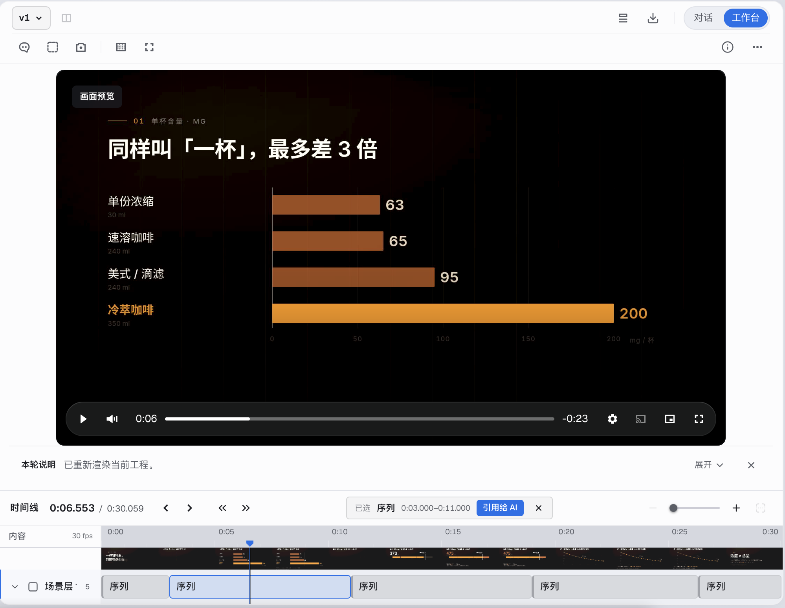

<div align="center">


# FengMotion

### 从一句话，到一条片子。

用自然语言创作视频，在画面中提出修改，让每一轮结果都有迹可循。

<p>
  
  
  
  
</p>

[下载试用](https://github.com/LuFering/FengMotion/releases) · [项目主页](https://lufering.github.io/FengMotion/) · [开发进度](PROGRESS.md) · [路线图](ROADMAP.md) · [反馈问题](https://github.com/LuFering/FengMotion/issues)

</div>

<p align="center">
  
</p>

<p align="center"><sub>真实桌面截图 · coffee 30 秒科普短片 · 成片预览、版本与片段定位<br />支持截图和区域引用。画面对象点选与属性面板尚未接入；后端已提供版本化文字编辑接口。</sub></p>

## 把想法做成可继续修改的工程

FengMotion 是一款本地运行的 AI 视频创作桌面应用。你描述内容、风格和修改意图，Agent 编写或修改真实的 Remotion 工程，应用负责渲染、保存版本和展示结果。需求、源码、素材与成片留在自己的电脑里；模型调用仍取决于你配置的服务。

可以从一句话开始，也可以带上图片、视频、参考片段或特效技法。不要求每次创作先写分镜或配置工作流。

```text
描述想法 → 选择参考与素材 → Agent 编写工程 → 渲染并保存版本
    ↑                                         ↓
    └──────── 引用画面 / 框选区域 / 指定时间段 ─────┘
```

| 创作 | 调整 | 积累 |
| :--- | :--- | :--- |
| 自然语言驱动代码与动画；过程展示阶段说明、工具调用和文件变更。 | 预览成片、定位片段、圈出画面区域，再把明确的修改要求交给 AI。 | 保留源码快照和视频版本，复用素材、参考片、技法与工作流预设。 |

## 当前能做到哪里

当前源码版本为 **0.1.3**，持续开发中。下表描述截至 **2026-11-20** 的实现；本地开发进展与公开安装包的发布时间分别记录。

| 能力 | 当前状态 |
| :--- | :--- |
| 对话创作与渲染 | 已接通 Agent 修改工程、后台创作任务、渲染和结果回读；需配置可用引擎与模型。 |
| 版本与轨道 | 源码快照、版本恢复、按视频保存轨道；有可靠历史来源时可补建轨道。已用 coffee 和独立样例实测。 |
| 画面反馈 | 当前帧、框选区域、时间范围可随意见传递；轨道片段可定位并引用给 AI。 |
| Skill → 工作流预设 | 支持导入、生成映射草稿、职责校验、人工审阅启用和关联项目。 |
| 素材与参考 | 支持素材、参考片段和技法管理及引用；送入上下文不等于模型已正确采用。 |
| 画面元素 | 后端提供按版本读取声明文字及修改文字、生成新版本的接口；当前桌面 UI 尚未接入元素点选与属性面板。 |
| 自动审片与多平台 | 完整视觉审片、自动返工仍需开发；有多平台打包配置，本轮桌面实测覆盖 Linux。 |

具体证据、限制和下一步见 [项目进度](PROGRESS.md)。新功能先在 [未发布记录](CHANGELOG.md) 中登记，不等同于已发布版本。

## 下载与运行

在 [GitHub Releases](https://github.com/LuFering/FengMotion/releases) 选择与你的系统匹配的实际发布资产。Linux AppImage 下载后赋予执行权限，例如：

```bash
chmod +x './FengMotion-<版本>-x86_64.AppImage'
'./FengMotion-<版本>-x86_64.AppImage'
```

桌面包包含后端、Java 运行时和渲染资源。AI 创作还需要本机配置可用的执行引擎与模型；DSH 路径见 [DeepSeek Harness](https://github.com/deepseek-ai/DeepSeek-Harness)。渲染依赖 Node.js，首次使用可能下载 Chromium。跨机器与其他平台的安装兼容性以实际验证为准。

<details>
<summary><strong>本地开发：依赖、启动与检查</strong></summary>

准备 Node.js 22.18+ 与 npm、Java 21、Maven；媒体元数据和缩略图需要 FFmpeg / ffprobe。Node.js 22.18+ 可直接运行仓库中导入 TypeScript 的 Node 测试。

**1. 获取源码与依赖**

```bash
git clone https://github.com/LuFering/FengMotion.git
cd FengMotion
npm --prefix frontend ci
npm --prefix desktop ci
```

**2. 启动后端**（从仓库根目录执行）

```bash
export FENGMOTION_REMOTION_DIR="$PWD/backend/remotion"
export FENGMOTION_NODE_MODULES="$PWD/frontend/node_modules"
export FENGMOTION_WORKFLOW_DIR="$PWD/frontend/workflow-v0.1.1"
cd backend
mvn spring-boot:run
```

显式指定目录可避免默认配置中的旧工作区相对路径影响首次启动。DSH 的 `patch`、provider 与 model 需按自己的环境设置，不能直接沿用示例值。详见 [后端说明](backend/README.md)。

**3. 在另一终端启动前端**

```bash
cd FengMotion/frontend
npm run dev
```

开发前端通常位于 `http://localhost:5173`，后端默认位于 `http://127.0.0.1:8080`。桌面壳启动后端时会选择端口并向前端传递实际地址。

**4. 检查与构建**（从仓库根目录执行）

```bash
curl http://127.0.0.1:8080/api/health
(cd backend && mvn clean package && node --test src/test/*.test.mjs)
(cd frontend && node --test tests/*.test.mjs && npm run build)
(cd desktop && npm run build:shell)
```

健康检查只证明服务启动，AI 创作和真实渲染需另行验证。桌面资源准备、安装和打包见 [desktop/README.md](desktop/README.md)。

</details>

## 工程与数据

| 目录 | 职责 | 深入阅读 |
| :--- | :--- | :--- |
| `backend/` | Java 21 / Spring Boot / SQLite；项目、对话、创作、渲染与产物模块 | [体系地图](backend/SYSTEM_MAP.md) · [开发指南](backend/DEVELOPMENT.md) |
| `frontend/` | React / TypeScript；工作台、场景编辑器、资源库与工作流 | [前端架构](frontend/ARCHITECTURE.md) |
| `desktop/` | Electron；桌面窗口、内置服务、运行资源与打包 | [桌面开发](desktop/README.md) |
| `frontend/workflow-v0.1.1/` | 创作方法、节点协议、模板与工具 | [工作流说明](frontend/workflow-v0.1.1/README.md) |
| `docs/` | 项目展示网站、契约、研究记录与 README 截图 | [截图来源](docs/assets/screenshots/README.md) |

Linux 默认项目目录为 `~/FengMotion/projects/`，应用数据位于 `~/.config/FengMotion/data/`。新渲染会保存源码快照、独立视频和对应轨道文件；恢复旧工程会新增版本，保留历史记录。请勿提交个人数据库、模型密钥或本机配置。

## 接下来

优先打通**工程版本 → 可编辑元素 → 受控修改 → 新版本渲染**：让画面中的标题、图形和图表参数能够绑定到真实工程。与此同时完善长任务恢复、错误诊断和部署一致性。具体拆分与验收条件见 [路线图](ROADMAP.md)。

欢迎通过 [Issues](https://github.com/LuFering/FengMotion/issues) 提交使用问题或创作案例，通过 [贡献指南](CONTRIBUTING.md) 参与开发。反馈时带上操作步骤、系统环境、所用版本及可分享的截图，会更容易复现和解决。
