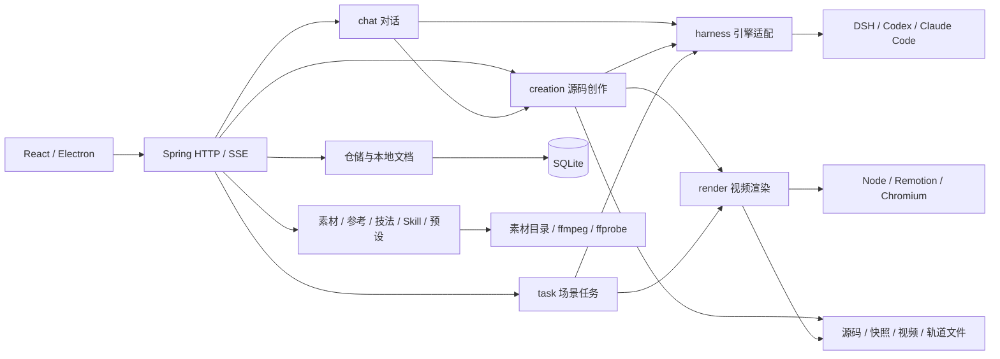
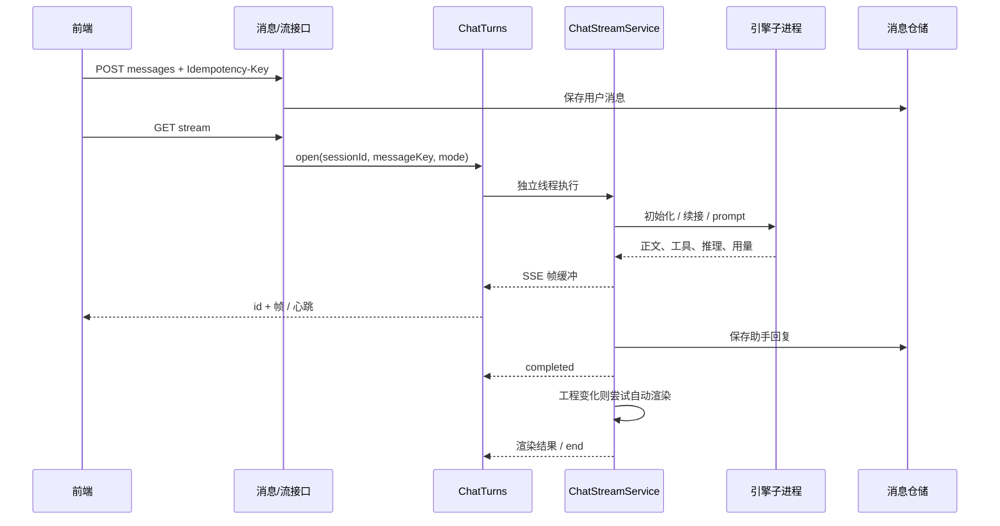

# 后端体系地图

核对日期：**2026-11-20**。基于当前工作区源码、Controller、存储实现及本轮测试。本文描述现状，待实现方案另列。

[运行说明](README.md) · [目录架构](ARCHITECTURE.md) · [开发指南](DEVELOPMENT.md) · [本轮核对记录](docs/audits/2026-11-20-system-baseline.md) · [项目进度](../PROGRESS.md)

## 1. 系统定位

后端是 **Java 21 / Spring Boot 3.3.5 模块化单体**。一个 Java 服务对桌面提供 HTTP / SSE，管理 SQLite、项目文件和外部子进程。当前 Maven 版本为 0.1.2，主要依赖为 MyBatis-Plus 3.5.18、SQLite JDBC 3.45.1.0、Jackson 和 Lombok，见 [pom.xml](pom.xml)。

当前盘点：18 个一级包、284 个生产 Java 文件（含 package-info）、36 个 REST Controller、114 个方法级路由声明、25 张由源码创建的表、108 个 Java 测试类。数量是源码快照，不是能力数或覆盖率。



图表示主要业务流，不是完整 Java 依赖图。

### 启动顺序

1. Electron 的 [backend.ts](../desktop/electron/backend.ts) 定位 JRE/JAR、选择空闲端口，传入数据、渲染和媒体工具路径；日志写入桌面 userData 的 `backend.log`。
2. [FengMotionServerApplication](src/main/java/com/fengmotion/server/FengMotionServerApplication.java) 在 Spring 启动前用 [StartupDirectories](src/main/java/com/fengmotion/server/config/StartupDirectories.java) 创建数据与项目目录。
3. Spring 执行 [schema.sql](src/main/resources/schema.sql)，[DatabaseMigration](src/main/java/com/fengmotion/server/config/DatabaseMigration.java) 补旧库列、表和数据；`LocalStateStore` 另外创建 `local_documents`。
4. 启动逻辑还包括项目指引升级、技法导入、旧任务收尾和异步语义索引；启动不是纯只读操作。
5. 桌面等待 `/api/health`，通过 preload 把实际 API 地址传给前端；端口未必是 8080。

默认部署面向本机单人使用，没有全局 Spring Security 鉴权体系。CORS 不是认证或执行沙箱；模型工具和渲染源码依赖当前用户权限及外部引擎策略。

## 2. 模块职责和开发落点

| 模块 | 职责 | 主要入口 | 边界 |
|---|---|---|---|
| `project` | 项目、目录、归档/清除、工程版本、指纹、快照、互斥、本地文档 | `ProjectCreationCoordinator`、`SceneVersionService`、`ProjectSourceSnapshots`、`LocalStateStore` | 工程版本不等于工作流 revision |
| `workflow` | 原始需求、纠正、工作稿、Prompt-first 初始化 | `WorkflowProjectService`、`WorkflowDraftService`、`WorkflowToolRunner` | 不是通用节点图执行引擎 |
| `creation` | 源码创作请求、资源上下文、Agent、渲染编排、轨道恢复、版本化元素写回 | `CreationJobs`、`ProjectCreationService`、`CreateAgentRunner`、`ProjectFilmRenderService`、`ProjectTimelineService`、`SceneElementEditService` | 与 `task` 各有生命周期；元素写回只支持声明文字 |
| `render` | Remotion 子进程、超时、轨道保存和视频规格探测 | `ProjectFilmRenderer`、`RemotionRenderer`、`VideoTimeline`、`VideoTimelineProbe` | 渲染完成不自动等于工程版本提交 |
| `artifact` | 项目文件列表、上传、内容读取 | `ArtifactController` | 产物列表扫描文件系统，没有独立视频产物表 |
| `chat` | 会话/消息、幂等、回复流、停止、回复保存 | `ChatMessageService`、`ChatTurns`、`ChatStreamService`、`CreationSessionBridge` | 消息数据库与 SSE 内存帧不同 |
| `harness` | 引擎探测、模型目录、协议、独立文本模型调用 | `HarnessService`、`DshSdkSession`、`NativeHarnesses`、`DshDirectTextModel` | DSH SDK 与原生 Codex/Claude 协议不同 |
| `task` | 场景 JSON 渲染/修改、事件、取消和恢复 | `TaskRequestGuard`、`TaskService`、`RenderTaskRunner`、`ModifyTaskRunner`、`TaskRecovery` | 只支持已实现的 kind/scope |
| `asset` | 素材导入、哈希去重、分片上传、文件夹、引用保护、缩略图 | `AssetService`、`AssetImportService`、`AssetStorage`、`UploadSessionService` | 素材副本不同于项目产物 |
| `reference` | 参考片、人工切段、观察/推断、集合、偏好 | `ReferenceVideoService`、`ReferenceCollectionService` | 自动分析接口明确返回不可用 |
| `fx` | 特效目录、来源扫描、GitHub 导入、语义建议、用户状态 | `FxTechniqueService`、`FxCapabilityImporter`、`SemanticSuggestionService` | 技法条目不是已执行的组件 |
| `retrieval` | 文本收集、向量索引、语义/字面检索 | `RetrievalCorpus`、`SemanticIndex`、`EmbeddingProvider` | 字面降级不是语义命中或视频理解 |
| `skill` | 下载、受限解压、静态清单、来源与引用分析 | `SkillPackageService`、`SkillArchiveExtractor`、`SkillInventoryScanner` | 导入不执行包内脚本 |
| `preset` | 映射草稿、职责校验、启用/归档、项目落地 | `WorkflowPresetService`、`PresetMappingValidator`、`MappingResponsibilities`、`PresetApplyService` | 校验通过不证明全部语义正确 |
| `upload` | 对话附件验证、保存、解析 | `UploadService` | 与素材库上传不同 |
| `system` | 健康和能力声明 | `SystemController` | health 不是完整链路就绪证明 |
| `common` | 业务异常、错误映射、分页 | `ApiException`、`ApiExceptionHandler` | 不承载业务任务状态 |
| `config` | 启动目录、数据库兼容、CORS、静态资源 | `StartupDirectories`、`DatabaseMigration`、`WebConfig` | 需核对配置的实际调用点 |

### 依赖方向

`creation` 直接依赖资源域、`harness`、`project`、`render`、`retrieval`、`workflow`；`chat` 依赖 `creation`；`task` 依赖 `chat`、`harness`、`project`、`render`；`preset` 依赖 `creation`、`harness`、`project`、`skill`、`workflow`。

两个已有协作接口防止反向引用：

- [CreationSessionAccess](src/main/java/com/fengmotion/server/creation/domain/CreationSessionAccess.java) 由 `chat.service.CreationSessionBridge` 实现，创作通过接口校验会话归属并保存回复。
- [ProjectCreationActivity](src/main/java/com/fengmotion/server/project/domain/ProjectCreationActivity.java) 由 `CreationJobs` 实现，工作稿查询项目活动时无需引用创作实现。

包内 `api / domain / service / store / client` 是组织约定，不要求每个模块凑齐所有层。`retrieval` 仍扁平，`artifact` 文件逻辑在 Controller，`fx` 语义建议仓储位于 `service/semantic`。不能因文档写了分层就认为实现已全部分层。模块无环由 [ModuleLayoutTest](src/test/java/com/fengmotion/server/architecture/ModuleLayoutTest.java) 检查。

## 3. 六条主要链路

### 3.1 对话：消息先保存，回复独立运行



- `START / ATTACH / RERUN` 区分新执行、仅订阅和明确重跑；`Last-Event-ID` 补发内存轮次中的帧。
- 断开 SSE 不等于停止 Agent；停止走会话 `/stop`，关闭登记的引擎进程。
- 每会话仅保留最近一轮帧缓冲；最终消息存 SQLite。重启后缓冲丢失，ATTACH 不自动重跑。
- DSH 经 `DshRpcTransport → DshTurnReader → DshTurnEvents`；`ChatReplyListener` 汇总，`ChatReplyStore` 在事务中取写锁、追加消息并更新会话。
- DSH 可续接外部持久会话；原生引擎使用各自协议和历史上下文，不能假定其续接语义相同。
- `ChatTurnRender` 比较源码指纹并尝试出片；助手 completed 不等于视频已渲染完成。
- `DshNarration` / 项目 `AGENTS.md` 约束按阶段说正文，不能把工具记录伪装成模型叙述。

源码：[ChatStreamController](src/main/java/com/fengmotion/server/chat/api/ChatStreamController.java)、[ChatTurns](src/main/java/com/fengmotion/server/chat/service/ChatTurns.java)、[ChatStreamService](src/main/java/com/fengmotion/server/chat/service/ChatStreamService.java)。Controller 注释中“不发 delta”“只校验 Last-Event-ID”已落后于实现，以方法和测试为准。

### 3.2 源码创作：请求 → Agent → 快照 → 渲染 → 版本

主要异步入口 `POST /projects/{projectId}/creation-jobs` 返回 202；`POST /workflow/create` 是仍保留的同步入口，两者进入 `ProjectCreationService`。

1. `CreationJobs` 校验请求身份及项目/会话/用户消息归属，保存 `local_documents[creation-request]`，再进入线程池。
2. `ProjectCreationService` 获取项目锁，检查 requestId 指纹、baseVersion 和截图，再追加纠正；完成的相同请求返回已有结果，身份复用于不同输入则拒绝。
3. `ResourceContextBuilder` 将资源 ID 转为路径/范围/用途；`CreateAgentRunner` 读取需求、纠正、Skill 指引，检索参考并调用引擎。
4. 资源沿用仅限同会话；省略引用与显式 `[]` 不同。源码指纹未变返回 `awaiting_info`，它只证明未改工程，不能断言模型在追问。
5. 工程变化后，`ProjectFilmRenderService` 捕获快照，从快照读取配置并渲染，再写视频旁的轨道清单。
6. `commitWithSnapshot` 按期望版本更新当前场景和历史；冲突清理本次未提交的视频与轨道。
7. 保存结果、助手回复和资源证据；回复写回失败可重试同步。`usageVerified=false` 不能被解释成已采用资源。

后端不通用执行前端节点图。图编排见 [workflowExecution.ts](../frontend/src/features/workflow/services/workflowExecution.ts)，图/版本/运行记录由本地文档服务保存，制作节点调用上述入口。

### 3.3 场景任务与同步场景渲染

`POST /projects/{projectId}/tasks → TaskRequestGuard → TaskService → RenderTaskRunner / ModifyTaskRunner`。

- `render` 接受 `film.scenes`，输出视频与轨道；单纯渲染任务不自动提交场景版本。
- `modify` 读取服务端当前 film，由 `ModelModifyPlanner` 生成方案、`ModifyPlanApplier` 校验；渲染后条件提交版本。
- 当前只支持 render / modify；修改范围 project / scene 已实现，selection 显式拒绝，不静默改成全片。
- 修改冲突保留并登记视频及轨道，但不成为当前版本；取消路径清理已渲染却不再需要的产物。
- 任务/事件成对持久化，事件 SSE 按数据库 seq 补发；`TaskRecovery` 收尾能确认 owner 已退出的遗留任务，不自动重执行。

`POST /projects/{projectId}/renders` 另有同步场景渲染入口，直接返回 artifact，不写场景版本，也不是云渲染作业。前端规划契约中的 202 + RenderJob 不能直接套用。

### 3.4 轨道与历史恢复

- `GET /timeline?path=...` 检查路径、结构、artifactPath 和视频 SHA-256。
- `POST /timeline/recover` 同步执行，项目锁内查询目标视频最新匹配版本；源码片核对快照并逐帧采集，场景片按原规则重建，再用 ffprobe 核对规格。
- 不可靠、超限或不完整清单不能开放精确片段修改；清单仅描述时间，不含元素命中或属性回写协议。
- `SceneVersionService.restore` 恢复工程并新增版本；源码恢复有备份/暂存和提交失败还原，但没有跨文件系统与 SQLite 的统一原子事务，强杀中断仍需恢复方案。
- `SceneEditMetadataService` 按指定版本校验源码快照并读取 `src/editable-elements.json`，当前只接受 `text`。无可用声明返回原因，不启动渲染或写工程；声明不证明实际画面几何。
- `SceneElementEditService` 在项目锁内从独立源码快照渲染，只修改 `properties.text`。渲染和工作区基线复核通过后同步声明并提交 `element_edit` 版本；旧快照和旧视频保持原样，提交失败回滚本次声明修改并清理新产物。见 [元素声明契约](../frontend/docs/contracts/scene-edit-metadata.md)。

### 3.5 Skill → 预设 → 项目

`GitHub archive → SkillArchiveExtractor → SkillInventoryScanner → skill_packages`；导入只做受限解压与静态分析。

`POST mappings → PresetMappingPrompt → DshPresetMappingModel / DshDirectTextModel → PresetMappingValidator → workflow_presets[draft]`。

映射调用不创建工具型 Agent。生成、编辑、启用均校验结构/职责；状态 draft → active → archived，来源绑定 commit。`PresetApplyService` 获取项目锁、检查在途创作，把指引与候选源码落入项目，保护用户已修改的工作稿。详见 [Skill 契约](../frontend/docs/contracts/skill-package.md)、[预设契约](../frontend/docs/contracts/workflow-preset.md)。

### 3.6 素材、参考、技法与检索

- `asset` 将原文件复制入素材库，按哈希去重，ffmpeg/ffprobe 生成缩略图与元数据；引用关系约束删除。
- `reference` 复用素材，维护切段、观察/推断和偏好；自动 `/analyze` 返回不可用。
- `fx` 按来源适配器扫描技法/组件，记录来源和许可；模型语义建议必须对应真实候选。
- `retrieval` 在 SQLite 保存文本与向量，应用内算相似度；HTTP 200 仍需读取 status/degraded/usable。字面降级需要可用索引原文。
- `upload` 管对话附件；`asset/uploads` 管素材分片。分片会话元数据在内存、文件在磁盘，不能承诺服务重启后续传。

## 4. 当前接口索引

以下均以 `/api` 为前缀，覆盖当前 Controller 路由族。请求字段以链接源码为准，前端契约可能包含尚未实现的设计。

| 路由族 | 方法 / 动作 | 源码 |
|---|---|---|
| `/health`、`/capabilities` | GET | [system/api](src/main/java/com/fengmotion/server/system/api) |
| `/harnesses`、`/{harnessId}/models` | GET；列表可 refresh | [harness/api](src/main/java/com/fengmotion/server/harness/api) |
| `/projects`、`/{id}` | POST / GET / PATCH / DELETE；删除含归档与 purge | [ProjectController](src/main/java/com/fengmotion/server/project/api/ProjectController.java) |
| `/projects/{projectId}/scene`、`/scene/versions` | GET 当前/历史；GET `/versions/{version}`；POST `/versions/{version}/restore` | [project/api](src/main/java/com/fengmotion/server/project/api) |
| `/projects/{projectId}/scene/versions/{version}/edit-metadata` | GET 版本绑定的元素声明或仅可预览原因 | [SceneVersionController](src/main/java/com/fengmotion/server/project/api/SceneVersionController.java) |
| `/projects/{projectId}/scene/versions/{version}/edit` | POST 带 `baseVersion` / `sourceHash` 的文字元素修改，渲染并提交新版本 | [SceneElementEditController](src/main/java/com/fengmotion/server/creation/api/SceneElementEditController.java) |
| `/projects/{projectId}/poster` | GET，指定 version | [ProjectPosterController](src/main/java/com/fengmotion/server/project/api/ProjectPosterController.java) |
| `/local-documents` | GET；PUT `/{namespace}/{id}` | [LocalStateController](src/main/java/com/fengmotion/server/project/api/LocalStateController.java) |
| `/projects/{projectId}/chat-sessions` | GET / POST | [ChatSessionController](src/main/java/com/fengmotion/server/chat/api/ChatSessionController.java) |
| `/chat-sessions/{sessionId}` | GET / DELETE；POST `/stop`；GET / POST `/messages`；GET `/stream` | [chat/api](src/main/java/com/fengmotion/server/chat/api) |
| `/projects/{projectId}/workflow` | GET；POST `/init`、`/corrections` | [WorkflowProjectController](src/main/java/com/fengmotion/server/workflow/api/WorkflowProjectController.java) |
| 同上 `/drafts` | GET 列表；GET / PUT `/{name}` | [WorkflowDraftController](src/main/java/com/fengmotion/server/workflow/api/WorkflowDraftController.java) |
| 同上 `/film`、`/create`、`/render` | GET 配置；POST 同步创作/渲染 | [CreationController](src/main/java/com/fengmotion/server/creation/api/CreationController.java) |
| 同上 `/creation`、`/creation-progress`、`/creation-rounds`、`/unsaved-replies`、`/preview-image-capability` | GET；另有 POST `/creation/{requestId}/sync-reply` | [CreationController](src/main/java/com/fengmotion/server/creation/api/CreationController.java) |
| `/projects/{projectId}/creation-jobs` | POST / GET；GET `/{id}`、`/{id}/resources`；POST `/{id}/cancel` | [CreationJobController](src/main/java/com/fengmotion/server/creation/api/CreationJobController.java) |
| `/projects/{projectId}/timeline` | GET；POST `/recover` | [ProjectTimelineController](src/main/java/com/fengmotion/server/creation/api/ProjectTimelineController.java) |
| `/projects/{projectId}/tasks`、`/tasks/{taskId}` | POST / GET 项目任务；GET 任务；POST `/cancel`；GET `/events`、`/events/snapshot` | [task/api](src/main/java/com/fengmotion/server/task/api) |
| `/projects/{projectId}/renders` | POST 同步场景渲染 | [RenderController](src/main/java/com/fengmotion/server/render/api/RenderController.java) |
| `/projects/{projectId}/artifacts` | GET / POST；GET `/content?path=...` | [ArtifactController](src/main/java/com/fengmotion/server/artifact/api/ArtifactController.java) |
| `/assets` | GET / POST；GET `/facets`；POST `/import`、`/batch-delete`；GET / PATCH / DELETE `/{assetId}`；GET `/{assetId}/content`、`/thumbnail` | [AssetController](src/main/java/com/fengmotion/server/asset/api/AssetController.java) |
| `/asset-folders` | GET / POST；PATCH / DELETE `/{folderId}` | [AssetFolderController](src/main/java/com/fengmotion/server/asset/api/AssetFolderController.java) |
| `/assets/uploads` | POST；GET / DELETE `/{uploadId}`；PUT `/{uploadId}/chunks/{index}`；POST `/{uploadId}/complete` | [AssetUploadController](src/main/java/com/fengmotion/server/asset/api/AssetUploadController.java) |
| `/reference-videos` | GET / POST；GET / PATCH / DELETE `/{videoId}`；GET / POST `/{videoId}/segments`；POST `/{videoId}/analyze`（未实现） | [ReferenceVideoController](src/main/java/com/fengmotion/server/reference/api/ReferenceVideoController.java) |
| `/reference-segments`、`/reference-collections`、`/reference-preferences` | 片段 GET / PATCH / DELETE；集合 GET / POST / PATCH / DELETE；偏好 GET / PATCH | [reference/api](src/main/java/com/fengmotion/server/reference/api) |
| `/fx-techniques` | GET 列表、`/facets`、`/{techniqueId}`；PATCH `/{techniqueId}/state`；POST `/github/import`；GET `/{id}/semantic-suggestions` | [fx/api](src/main/java/com/fengmotion/server/fx/api) |
| `/retrieval/search` | GET q / kinds / limit | [RetrievalController](src/main/java/com/fengmotion/server/retrieval/RetrievalController.java) |
| `/skill-packages` | POST `/import`；GET 列表 / `/{id}`；DELETE `/{id}` | [SkillPackageController](src/main/java/com/fengmotion/server/skill/api/SkillPackageController.java) |
| `/skill-packages/{packageId}/mappings`、`/workflow-presets` | POST 生成；GET 列表 / `/{id}`；PUT `/{id}/mapping`；POST `/{id}/activate`；DELETE `/{id}` 归档 | [WorkflowPresetController](src/main/java/com/fengmotion/server/preset/api/WorkflowPresetController.java) |
| `/projects/{projectId}/workflow/preset` | GET / POST | [ProjectPresetController](src/main/java/com/fengmotion/server/preset/api/ProjectPresetController.java) |
| `/uploads` | POST 对话附件 | [UploadController](src/main/java/com/fengmotion/server/upload/api/UploadController.java) |

另有 `WebConfig` 挂载 `/api/capability-assets/**` 静态资源。当前没有自动生成的 OpenAPI 作为统一事实来源。

### 错误与能力声明

- 可预期失败一般是 `{error:{code,message,requestId}}`；映射错误有专用 advice，SSE 前置失败手写 JSON，流中失败写事件。
- `ApiExceptionHandler` 只覆盖指定异常，不能认为 ResponseStatusException 等全部返回同一信封。
- requestId 多在错误处新建，还不是贯穿 HTTP/Agent/渲染/数据库的 traceId。
- 前端 `ApiError` 把不认识的专用 code 放在 `details.rawCode`；新增错误分支需联动客户端。
- `/capabilities` 除 agent 探测外，仍固定返回部分 unavailable（含 previewVideo），实际已有视频内容路由。`preview-image-capability` 是接口支持声明，不是所有模型的图像能力探测。

## 5. 数据体系与事实来源

### SQLite 的 25 张表

| 归属 | 表 | 内容 |
|---|---|---|
| 项目 | `projects`、`project_idempotency` | 元数据、根目录、ETag、创建幂等 |
| 会话 | `chat_sessions`、`chat_messages`、`chat_message_idempotency` | 外部会话绑定、消息及工具/推理/用量/产物字段、幂等 |
| 场景任务 | `tasks`、`task_events` | 状态、产物、owner、事件 seq |
| 源码创作 | `workflow_creation_tasks` | requestId、输入指纹、会话/消息、阶段与结果 |
| 版本 | `project_scenes`、`project_scene_versions` | 当前版本和历史 film；可为场景数据或 project-render 描述 |
| 素材 | `assets`、`asset_folders`、`resource_refs` | 文件元数据、文件夹、资源使用关系 |
| 特效 | `fx_techniques`、`fx_user_state`、`fx_semantic_suggestions` | 技法、收藏等用户状态、语义建议 |
| 参考 | `reference_videos`、`reference_segments`、`reference_collections`、`reference_collection_members`、`reference_preferences` | 参考片、切段、集合、偏好 |
| 检索 | `semantic_index` | 文本、内容哈希、模型标识和向量 BLOB |
| Skill/预设 | `skill_packages`、`workflow_presets` | 固定来源包清单和映射 |
| 通用文档 | `local_documents` | 带 revision 的工作流/运行/审阅/编辑器/创作请求 |

23 张表在 schema.sql 和 DatabaseMigration 中都有创建语句；project_idempotency 由迁移创建；local_documents 由 LocalStateStore.init 创建。没有 Flyway/Liquibase 版本迁移目录。

存储是混合实现：大部分实体走 MyBatis；`SqliteProjectSceneRepository`、`SqliteProjectPurgeRepository`、`CreationTaskStore`、`LocalStateStore`、语义索引和语义建议等直接用 JDBC。旧注释“业务读写统一由 MyBatis 执行”不准确。

### local_documents 的八种 namespace

| namespace | 写入方 / 语义 |
|---|---|
| `workflow`、`workflow-run`、`workflow-version` | 前端图定义、运行记录、不可覆盖定义快照 |
| `review`、`editor-document`、`editor-render` | 前端审阅、编辑文档、试片 |
| `creation-request`、`resource-evidence` | 后端创作请求及证据，公共写接口不允许 |

主键 `(namespace, document_id)`；expectedRevision 条件更新，相同内容可幂等重试。workflow-version 已存在且内容不同则拒绝。公共列表排除后端创作请求/资源证据；存储内部 list() 仍读全部文档，扩展时需考虑过滤和分页。

### 文件系统

```text
应用数据目录（默认 ~/.config/FengMotion/data）
├── fengmotion.db
├── library/assets/<哈希分桶>/original.<ext>、thumb.webp
├── library/.uploads/                     素材分片
├── uploads/                              对话附件
└── skill-packages/                       来源包副本

项目根目录（projects.root_path）
├── AGENTS.md                             项目指引
├── prompt.original.md、corrections.md     原文与追加意见
├── lookdev-brief.md、film-plan.md         工作稿
├── resources-in-use.md、retrieval-log.md  资源上下文与检索记录
├── skill-guide.md、creation-state.json   方法指引与最近创作状态
├── src/、public/、film.config.json、package.json
├── renders/
│   ├── <视频文件>
│   └── .<视频文件名>.sequences.json       绑定视频哈希的旁车清单
└── .fengmotion/
    ├── source-snapshots/<ID>/             源码/素材快照及 source.sha256
    ├── restore-backups/<ID>/              工程恢复备份
    ├── preset.json、skill-sources/        应用预设及候选源码
    └── posters/                          封面缓存
```

文件存在不代表有对应工程版本。源码快照目前包括 src、public、film.config.json、package.json，不包括外部绝对路径、网络资源和共享 node_modules；固定快照不保证动态/外部输入完全可重现。

### 内存与外部状态

| 状态 | 持有者 | 重启后 |
|---|---|---|
| 最近轮次 SSE 帧 | `ChatTurns` | 丢失；已保存消息仍在 |
| 活跃引擎进程/停止位 | `ChatStreamService` | 进程控制信息失效；外部引擎会话单独持久化 |
| 创作线程/取消位/在途项目 | `CreationJobs` | 请求文档仍在，可识别 interrupted；线程不恢复 |
| 阶段正文 | `CreationProgressStore` | 丢失；项目/会话内实时投影，最多 12,000 字符 |
| 场景任务句柄 | `TaskService` | 历史/事件仍在，已退出 owner 可被收尾 |
| 项目锁 | `ProjectOperationLock` | 仅本 JVM 有效，外部编辑不受保护 |
| 分片会话 | `UploadSessionService` | 分片可能仍在，内存会话不在 |
| 探测缓存 | `HarnessService` | 可重新探测，不是业务结果 |

DSH 的 provider 配置与外部会话属于本机引擎；只备份 SQLite 不能备份全部项目、模型配置和引擎会话。

## 6. 并发、事务与失败边界

| 路径 | 调度 / 互斥 | 持久化与失败语义 |
|---|---|---|
| 对话 | cached thread pool；单会话轮次保护 | 消息事务；内存帧重连；停止不回滚源码 |
| 创作作业 | 2 worker + 20 等待队列；在途项目登记；项目锁 | 请求文档/任务表；队列满保存 failed；取消中断线程 |
| 场景任务 | 2 worker，fixed pool 默认无界等待队列 | 任务/事件事务、版本条件提交、独立取消与 owner 恢复 |
| 同步渲染/轨道恢复 | 请求线程；源码路径使用项目锁 | 耗时可能超过普通客户端超时，不属于后台队列 |
| 启动索引 | Spring @Async | 失败不阻塞应用，响应区分降级 |
| 场景任务 SSE | 每订阅一个 scheduled pump | 数据库 seq 回放；断连释放 pump |

开发时必须保持：

1. 项目、会话、消息、请求 ID、工程版本和工作流 revision 各有身份，不能互换。
2. 修改提交校验基线，版本单调递增，恢复也新增版本。
3. 收到资源、执行工具、保存回复、渲染成功和提交版本分别是独立事实。
4. 文件与数据库不共享事务；依赖备份、清理和状态回读。不要用长数据库事务包住模型/渲染调用。
5. 项目锁不是跨进程锁，也未覆盖所有入口：对话 Agent 写文件阶段、旧场景任务等需单独分析。
6. 项目清除的在途检查目前查询旧 tasks，尚未统一检查源码创作与对话执行。

## 7. 配置与部署

配置分布在 [application.yml](src/main/resources/application.yml)、Java 的 @Value 默认值、[HarnessProperties](src/main/java/com/fengmotion/server/harness/config/HarnessProperties.java)、桌面启动参数和打包脚本中。

| 配置组 | 当前关键项 | 注意点 |
|---|---|---|
| 服务/目录 | loopback；data-dir、workspace-root、upload-root | 启动前目录准备只认 `--key=value` 和默认值，自定义覆盖需核对 |
| 渲染 | project-dir、node-modules、browser、node；场景 600 秒，源码 900 秒 | 源码超时默认在 Java；stdout 为结果 JSON，stderr 为诊断 |
| 创作 | workflow.dir；agent-timeout-seconds 默认 1200 | 初始化工具的 node/timeout 另有默认值 |
| 对话 | bin/profile/patch/provider/model、探测缓存 | 当前 ChatStreamService.turnBudget 为 6 小时，旧 turn-timeout/background-budget 配置不是该入口实际上限 |
| 映射 | mapping-timeout-ms 默认 120000；独立 provider/model | 默认沿用 harness，独立文本调用不走 Agent 会话 |
| 检索 | enabled、capabilities-dir、embedding key/endpoint/timeout | enabled 控制启动建索引；测试还需清空 key，避免继承环境调用外部服务 |
| 素材 | library-root、ffmpeg、ffprobe | 路径与二进制来源要覆盖安装态 |
| Skill | root、解压文件/字节上限 | 不执行包内脚本 |
| 文档 | local-documents.max-bytes 默认 16,000,000 | 当前按 JSON 字符长度检查，不是严格字节计数 |
| Web | cors.allowed-origins、fx.assets-dir | fengmotion://app 跨域与静态素材映射需同时核对 |

必须分别记录“源码已改”“已安装桌面更新”“公开 Release”。`mvn test` 不打新 JAR，`deploy-desktop.mjs --dist` 不更新后端；运行中覆盖 JAR 不等于重启。渲染脚本部署须包含 timeline.mjs 和匹配版本的共享依赖。

## 8. 已确认缺口与开发切入点

以下是源码盘点结果，不是本轮修复项或全部漏洞审计结论。

| 问题 | 当前依据 | 后续切入 |
|---|---|---|
| 任意源码元素编辑缺失 | 后端支持已声明文字的版本化读写；工作台仍播放 MP4，轨道只有时间信息 | 由独立前端实现拾取和属性面板，再扩展有明确绑定的元素类型 |
| 任务机制分散 | ChatTurns、CreationJobs、TaskService 和同步恢复分别处理 | 先定义共同状态语义，再抽复用；不直接合并历史表 |
| 生命周期检查不完整 | purge 的在途检查只读 tasks；项目锁覆盖范围有限 | 覆盖对话、源码创作、渲染、恢复与删除的竞态测试 |
| 路径规则不一致 | VideoTimeline 检查真实路径；ArtifactController.content 目前只 normalize/startsWith，未解析符号链接 | 统一文件边界和测试；不能声称所有文件接口同等保护 |
| 列表加载成本 | LocalStateStore.list 读全量；CreationJobs.list 再过滤 | 测量数据规模，服务端过滤/分页；轨道版本查询已单独优化 |
| 内存/线程边界 | 对话 cached pool、轮次帧数组、任务无界等待队列 | 建立并发/内存预算与背压验证 |
| 配置/能力/注释漂移 | 固定能力声明、旧超时字段、过时流说明 | 校对实际行为、客户端消费和文档 |
| 多资源一致性 | 文件、版本、任务、状态文件分开保存 | 故障注入、补偿与中断恢复，不用“有事务”概括全链路 |
| 初始化分散 | schema、迁移、LocalStateStore 各有建表 | 在不破坏旧库的前提下统一迁移入口 |

建议后续任务从“用户问题 → 权威数据 → 执行入口 → 提交点 → 失败恢复 → 测试与文档”展开，具体模板和验证矩阵见 [DEVELOPMENT.md](DEVELOPMENT.md)。
